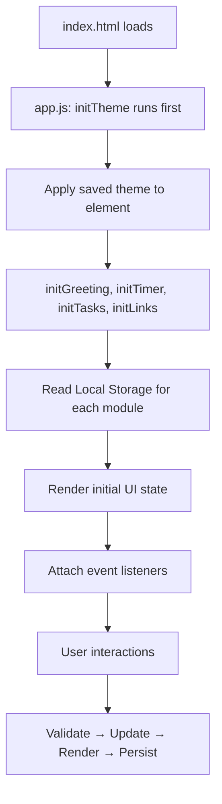

# Design Document: To-Do Life Dashboard

## Overview

The To-Do Life Dashboard is a single-page web application that runs entirely in the browser — no server, no build tools, no frameworks. You open `index.html` and it just works.

The app is built with three files:

- `index.html` — the page structure
- `css/style.css` — all visual styling
- `js/app.js` — all interactive behavior

Everything the user saves (tasks, links, name, timer duration, theme preference) is stored in the browser's **Local Storage**, a built-in key/value store that persists across browser sessions on the same device.

This design is intentionally beginner-friendly. Each feature is implemented as a self-contained module inside `app.js`, using plain functions — no classes, no frameworks, just readable vanilla JavaScript.

---

## Architecture

The app follows a **read → update → render → persist** cycle for every user interaction:

```
User Action
    │
    ▼
Read current state (from JS variables or DOM)
    │
    ▼
Validate input (if any)
    │
    ▼
Update in-memory state
    │
    ▼
Re-render affected section of the DOM
    │
    ▼
Persist updated state to Local Storage
```

Because there is no framework, the DOM is the source of truth for visual state, and Local Storage is the source of truth for persisted data. On page load, the app reads from Local Storage and renders the initial UI.

### Module Breakdown

`app.js` is organized into five logical sections, one per feature:

| Section | Responsibility |
|---|---|
| `greeting` | Time/date display, greeting message, custom name |
| `timer` | Pomodoro countdown, start/stop/reset, audio alert |
| `tasks` | To-do list CRUD, Local Storage persistence |
| `links` | Quick links CRUD, Local Storage persistence |
| `theme` | Light/dark mode toggle, flash-free theme loading |

Each section exposes a small set of pure helper functions plus event handlers that wire them to the DOM.

### Diagram



---

## Components and Interfaces

### 1. Greeting Widget

**HTML elements:**
- `#greeting-text` — `<h1>` showing "Good Morning, Alex!"
- `#date-text` — `<p>` showing "Monday, July 14, 2025"
- `#time-text` — `<p>` showing "09:45 AM"
- `#name-input` — `<input type="text" maxlength="50">`
- `#name-save-btn` — `<button>` to save the name
- `#name-error` — `<span>` for validation error messages

**Key functions:**

```js
// Returns "Good Morning", "Good Afternoon", "Good Evening", or "Good Night"
// based on the hour (0–23). Returns "Hello" if hour is not a valid number.
function getGreeting(hour)

// Returns a formatted time string like "09:45 AM" from a Date object
function formatTime(date)

// Returns a formatted date string like "Monday, July 14, 2025" from a Date object
function formatDate(date)

// Combines greeting + name into "Good Morning, Alex!" or "Good Morning!" if no name
function buildGreetingWithName(greeting, name)

// Called every 60 seconds via setInterval to refresh time, date, and greeting
function updateGreeting()

// Saves a validated, trimmed name to Local Storage and re-renders the greeting
function saveName(rawInput)
```

**Initialization:**
```js
function initGreeting() {
  // 1. Load saved name from Local Storage
  // 2. Render current time, date, and greeting immediately
  // 3. Start setInterval(updateGreeting, 60000)
  // 4. Attach click/keydown listeners to save button and input
}
```

---

### 2. Pomodoro Timer

**HTML elements:**
- `#timer-display` — `<div>` showing "25:00"
- `#timer-start-btn` — Start button
- `#timer-stop-btn` — Stop button
- `#timer-reset-btn` — Reset button
- `#timer-duration-input` — `<input type="number">` for custom duration (1–120)
- `#timer-duration-submit` — button to apply custom duration
- `#timer-duration-error` — validation error span
- `#timer-done-msg` — hidden notification shown when timer ends (fallback for no-audio)

**Timer state (module-level variables):**
```js
let timerInterval = null;  // holds the setInterval ID, or null if not running
let remainingSeconds = 25 * 60;  // current countdown value in seconds
let configuredSeconds = 25 * 60; // the "reset" value in seconds
```

**Key functions:**

```js
// Converts a total seconds value into "MM:SS" string, zero-padded
function formatTime(totalSeconds)

// Validates a duration in minutes: returns true if between 1 and 120
function validateDuration(minutes)

// Starts the countdown (sets setInterval that decrements remainingSeconds each second)
function startTimer()

// Pauses the countdown (clears the interval)
function stopTimer()

// Stops and resets remainingSeconds to configuredSeconds
function resetTimer()

// Called every second by setInterval — decrements remaining, handles 00:00
function tick()

// Plays audio alert; shows fallback notification if audio fails
function handleTimerEnd()

// Saves configuredSeconds to Local Storage
function saveTimerDuration()
```

**Initialization:**
```js
function initTimer() {
  // 1. Load saved duration from Local Storage (validate 1–120 range)
  // 2. Set remainingSeconds and configuredSeconds
  // 3. Render initial display
  // 4. Attach button and input listeners
}
```

---

### 3. To-Do List

**HTML elements:**
- `#task-input` — text input for new task name
- `#task-add-btn` — Add button
- `#task-input-error` — validation error span
- `#task-list` — `<ul>` where tasks are rendered

Each task item is rendered as a `<li>` with this structure:
```html
<li data-id="[unique-id]">
  <input type="checkbox" class="task-checkbox" />
  <span class="task-text">Buy groceries</span>
  <button class="task-edit-btn">Edit</button>
  <button class="task-delete-btn">Delete</button>
</li>
```

When in edit mode, the `<span>` is replaced with:
```html
<input type="text" class="task-edit-input" value="Buy groceries" maxlength="100" />
<button class="task-save-btn">Save</button>
<button class="task-cancel-btn">Cancel</button>
```

**Task data structure (stored in Local Storage as JSON):**
```json
[
  {
    "id": "abc123",
    "text": "Buy groceries",
    "completed": false
  }
]
```

**Key functions:**

```js
// Returns true if text is 1–100 non-whitespace characters
function validateTaskText(text)

// Generates a unique ID string (using Date.now() + random suffix)
function generateId()

// Adds a new task object to the tasks array and re-renders
function addTask(text)

// Updates an existing task's text and re-renders
function editTask(id, newText)

// Toggles the completed boolean on a task and re-renders
function toggleTask(id)

// Removes a task by id and re-renders
function deleteTask(id)

// Renders the entire task list to the DOM from the tasks array
function renderTasks()

// Reads the tasks array from Local Storage (returns [] if missing/invalid)
function loadTasks()

// Writes the tasks array to Local Storage as JSON
function saveTasks()
```

**Initialization:**
```js
function initTasks() {
  // 1. Load tasks array from Local Storage
  // 2. Render all tasks
  // 3. Attach listeners to input, add button (using event delegation on #task-list)
}
```

> **Event delegation** is used for the task list: instead of attaching a listener to every button in every `<li>`, one listener is attached to `#task-list` and checks `event.target` to know which button was clicked. This is simpler and more efficient.

---

### 4. Quick Links

**HTML elements:**
- `#link-name-input` — text input for link name (1–50 chars)
- `#link-url-input` — text input for URL (must start with `http://` or `https://`)
- `#link-add-btn` — Add Link button
- `#link-error` — validation error span
- `#links-grid` — container where link buttons are rendered

Each link is rendered as:
```html
<div class="link-item" data-id="[unique-id]">
  <a href="[url]" target="_blank" rel="noopener noreferrer">[name]</a>
  <button class="link-delete-btn">Delete</button>
</div>
```

**Link data structure (stored in Local Storage as JSON):**
```json
[
  {
    "id": "def456",
    "name": "GitHub",
    "url": "https://github.com"
  }
]
```

**Key functions:**

```js
// Returns true if name is 1–50 characters (trimmed)
function validateLinkName(name)

// Returns true if url starts with http:// or https://
function validateLinkUrl(url)

// Adds a new link to the array (rejects if 20 already exist) and re-renders
function addLink(name, url)

// Removes a link by id and re-renders
function deleteLink(id)

// Renders all links to the DOM from the links array
function renderLinks()

// Reads the links array from Local Storage
function loadLinks()

// Writes the links array to Local Storage as JSON
function saveLinks()
```

**Initialization:**
```js
function initLinks() {
  // 1. Load links array from Local Storage
  // 2. Render all links
  // 3. Attach listeners to inputs, add button, and links grid (event delegation)
}
```

---

### 5. Theme Toggle

**HTML elements:**
- `#theme-toggle-btn` — toggle button (e.g., "🌙 Dark Mode" / "☀️ Light Mode")

**How theming works:**

The theme is applied by toggling a `data-theme` attribute on the `<html>` element:

```html
<!-- Light mode (default) -->
<html data-theme="light">

<!-- Dark mode -->
<html data-theme="dark">
```

CSS uses attribute selectors to apply theme-specific colors:
```css
[data-theme="light"] { --bg: #ffffff; --text: #333333; }
[data-theme="dark"]  { --bg: #1a1a2e; --text: #eaeaea; }
```

**Flash prevention:** `initTheme()` must run as the very first script call in `app.js` (before `DOMContentLoaded`), reading the theme from Local Storage and applying it to `<html>` synchronously. This ensures the correct theme is in place before the browser paints any content.

**Key functions:**

```js
// Reads saved theme, applies to <html>, updates button label
function initTheme()

// Toggles between "light" and "dark", saves to Local Storage
function toggleTheme()
```

---

## Data Models

All data is stored in `localStorage` using `JSON.stringify` / `JSON.parse`. Below are the keys and their shapes.

### Local Storage Keys

| Key | Value Type | Description |
|---|---|---|
| `dashboard_name` | `string` | User's display name (trimmed, 1–50 chars) |
| `dashboard_timer_duration` | `number` | Timer duration in minutes (1–120) |
| `dashboard_tasks` | `JSON array` | Array of Task objects |
| `dashboard_links` | `JSON array` | Array of Link objects |
| `dashboard_theme` | `string` | `"light"` or `"dark"` |

### Task Object

```json
{
  "id": "string — unique identifier (e.g., '1720000000000-42')",
  "text": "string — task description, 1–100 characters",
  "completed": "boolean — whether the task is done"
}
```

### Link Object

```json
{
  "id": "string — unique identifier",
  "name": "string — display label, 1–50 characters",
  "url": "string — full URL starting with http:// or https://"
}
```

### ID Generation

IDs are generated with:
```js
function generateId() {
  return Date.now().toString(36) + Math.random().toString(36).slice(2, 6);
}
```

This gives a short, unique-enough string for a client-only app with no server.

### Local Storage Write Safety

Every write to Local Storage is wrapped in a `try/catch`:
```js
function saveTasks() {
  try {
    localStorage.setItem('dashboard_tasks', JSON.stringify(tasks));
  } catch (e) {
    showError('Could not save your changes. Local Storage may be full.');
  }
}
```

This handles edge cases like private browsing mode with storage disabled or a full storage quota.

---

## Correctness Properties

*A property is a characteristic or behavior that should hold true across all valid executions of a system — essentially, a formal statement about what the system should do. Properties serve as the bridge between human-readable specifications and machine-verifiable correctness guarantees.*

---

### Property 1: Greeting maps correctly for all hours

*For any* hour value in the range 0–23, `getGreeting(hour)` should return exactly one of `"Good Morning"`, `"Good Afternoon"`, `"Good Evening"`, or `"Good Night"`, consistent with the time-range boundaries defined in Requirements 2.1–2.4. No valid hour should produce an unrecognized greeting string.

**Validates: Requirements 2.1, 2.2, 2.3, 2.4**

---

### Property 2: Time formatting always produces valid MM:SS or HH:MM AM/PM output

*For any* non-negative integer number of seconds in the range [0, 7199] (0 to 119 minutes 59 seconds), `formatTime(seconds)` should return a string matching the pattern `^\d{2,3}:\d{2}$` with zero-padded values.

**Validates: Requirements 4.1**

---

### Property 3: Whitespace-only names are always rejected

*For any* string composed entirely of whitespace characters (spaces, tabs, newlines), `validateName(s)` should return `false`, ensuring such a name is never saved to Local Storage and the existing stored name is never overwritten.

**Validates: Requirements 3.6**

---

### Property 4: Name save-load round trip preserves trimmed value

*For any* name string (including one with leading/trailing whitespace), saving it via `saveName(name)` and then loading it via `loadName()` should return the trimmed version of the name — never the un-trimmed version, and never a different string.

**Validates: Requirements 3.2, 3.3, 3.4**

---

### Property 5: Valid task addition grows the task list by exactly one

*For any* task list state and any task name string that passes validation (1–100 non-whitespace characters), calling `addTask(text)` should result in the task list having exactly one more item than before, and that item should have `text` equal to the trimmed input.

**Validates: Requirements 6.2, 6.3**

---

### Property 6: Whitespace-only and oversized task names are always rejected

*For any* string that is either composed entirely of whitespace or has a trimmed length greater than 100 characters, `validateTaskText(s)` should return `false`, and `addTask(s)` should leave the task list unchanged.

**Validates: Requirements 6.5, 6.6**

---

### Property 7: Task add-load round trip preserves all tasks

*For any* sequence of valid `addTask` calls, calling `saveTasks()` followed by `loadTasks()` should return an array containing all the same tasks (same id, text, and completed values) in the same order.

**Validates: Requirements 6.4, 8.1, 8.2**

---

### Property 8: Task completion toggle is an involution

*For any* task in the list, calling `toggleTask(id)` twice should return the task to its original `completed` state. In other words, toggling is self-inverse: `toggle(toggle(task)) === task.completed`.

**Validates: Requirements 7.6, 7.7**

---

### Property 9: Task deletion removes exactly the targeted task

*For any* task list with N items and any valid task id, calling `deleteTask(id)` should result in a list of exactly N-1 items, where no item has that id, and all other tasks remain unchanged.

**Validates: Requirements 7.8**

---

### Property 10: Valid task edits persist the new text

*For any* existing task and any replacement text that passes validation (1–100 non-whitespace chars), `editTask(id, newText)` should update only that task's `text` field, leave all other tasks unchanged, and saving then loading should return the updated text.

**Validates: Requirements 7.3**

---

### Property 11: URL validation correctly accepts and rejects inputs

*For any* string that starts with `http://` or `https://`, `validateLinkUrl(s)` should return `true`. *For any* string that does not start with either prefix, it should return `false`.

**Validates: Requirements 9.5**

---

### Property 12: Valid link addition grows the links list by exactly one

*For any* links list with fewer than 20 items, and any valid name/URL pair, calling `addLink(name, url)` should result in the links list having exactly one more item with the correct name and url.

**Validates: Requirements 9.2**

---

### Property 13: Links list never exceeds 20 items

*For any* sequence of `addLink` calls, the links array length should never exceed 20. Any call that would push the count above 20 should be rejected without modifying the list.

**Validates: Requirements 9.6**

---

### Property 14: Link deletion removes exactly the targeted link

*For any* links list and any valid link id, calling `deleteLink(id)` should result in a list where no item has that id, and all other links remain unchanged.

**Validates: Requirements 10.2**

---

### Property 15: Theme save-load round trip preserves the selected theme

*For any* theme value (`"light"` or `"dark"`), saving it via the theme toggle and then reading it back from Local Storage should return the exact same value.

**Validates: Requirements 12.3, 12.4**

---

### Property 16: Timer duration validation rejects out-of-range values

*For any* number outside the range [1, 120], `validateDuration(n)` should return `false`. *For any* integer in [1, 120], it should return `true`.

**Validates: Requirements 5.5**

---

### Property 17: Timer never counts below zero

*For any* timer state where `remainingSeconds === 0`, calling `tick()` any number of times should leave `remainingSeconds` at 0 and not trigger additional timer-end actions beyond the first.

**Validates: Requirements 4.8**

---

## Error Handling

### Input Validation Errors

Each feature has a dedicated error `<span>` element that displays validation messages inline, near the relevant input. Error messages are cleared when the user starts typing again.

| Scenario | Message |
|---|---|
| Empty/whitespace name | "Name cannot be empty." |
| Empty/whitespace task | "Task name cannot be empty." |
| Task name too long | "Task name must be 100 characters or fewer." |
| Timer duration out of range | "Please enter a duration between 1 and 120 minutes." |
| Link name empty | "Link name cannot be empty." |
| Link name too long | "Link name must be 50 characters or fewer." |
| Invalid URL | "URL must start with http:// or https://" |
| 20 links already saved | "Maximum of 20 links reached. Please delete one first." |

### Local Storage Failures

All `localStorage.setItem` calls are wrapped in `try/catch`. On failure, a transient error toast (a small message that disappears after 3 seconds) is shown to the user: `"Could not save your changes. Storage may be full."`.

### Audio Playback Failures

`audio.play()` returns a Promise. A `.catch()` handler catches rejection (e.g., the browser blocked autoplay) and calls a `showTimerDoneNotification()` function instead, which makes `#timer-done-msg` visible for 5 seconds.

### Missing or Corrupt Local Storage Data

On page load, all Local Storage reads are wrapped in `try/catch` with `JSON.parse`. If parsing fails or the value is `null`, the module falls back to its default state (empty arrays, default durations, "light" theme, no name).

---

## Testing Strategy

This project uses a dual approach: **unit tests** for specific examples and edge cases, and **property-based tests** for universal behavioral properties.

Because the codebase is pure JavaScript with no build step, tests are written using **[Jest](https://jestjs.io/)** (unit + property framework via `fast-check`) and run with Node.js. CommonJS exports expose the actual application functions without starting the dashboard on import. Tests use the real HTML body in jsdom and control time with Jest fake timers.

DOM-dependent behavior (rendering, event handlers) is tested using **jsdom** (provided by `jest-environment-jsdom`).

### Property-Based Testing Library

**[fast-check](https://github.com/dubzzz/fast-check)** is the property-based testing library for this project.

- Each property test runs a minimum of **100 iterations**
- Each test is tagged with a comment referencing the design property it validates
- Tag format: `// Feature: todo-life-dashboard, Property {N}: {property_text}`

### Unit Test Focus Areas

Unit tests cover specific scenarios that property tests don't naturally reach:

- **Initialization**: Page load with no Local Storage data defaults correctly
- **Audio fallback**: `audio.play()` rejection triggers the visible notification
- **Local Storage failure**: `setItem` throwing shows the error toast
- **Edit cancel**: Canceling an edit restores the original task text
- **Timer state machine**: Start → Stop → Reset transitions work correctly
- **Link open in new tab**: Rendered links use a normal anchor with the saved URL, `target="_blank"`, and `rel="noopener noreferrer"`

### Property Test Coverage

Each correctness property (Properties 1–17) maps to one property-based test:

| Property | Description | Generator Inputs |
|---|---|---|
| 1 | Greeting maps hours to correct string | `fc.integer({ min: 0, max: 23 })` |
| 2 | Timer formatTime output is valid MM:SS | `fc.integer({ min: 0, max: 7199 })` |
| 3 | Whitespace names are rejected | `fc.stringOf(fc.constantFrom(' ', '\t', '\n'))` |
| 4 | Name save-load round trip | `fc.string({ minLength: 1, maxLength: 50 })` |
| 5 | Adding a valid task grows the list | `fc.string({ minLength: 1, maxLength: 100 })` |
| 6 | Invalid task names are rejected | whitespace strings + strings of length > 100 |
| 7 | Task add-load round trip | sequences of valid task strings |
| 8 | Toggle completion is self-inverse | any task object |
| 9 | Task deletion removes only the target | any task list + valid id |
| 10 | Task edits persist new text | any task + valid replacement string |
| 11 | URL validation | `fc.string()` (positive and negative cases) |
| 12 | Adding a valid link grows the list | valid name/url pairs, list size < 20 |
| 13 | Links list never exceeds 20 items | sequences of addLink calls |
| 14 | Link deletion removes only the target | any links list + valid id |
| 15 | Theme save-load round trip | `fc.constantFrom("light", "dark")` |
| 16 | Timer duration validation | `fc.integer({ min: -1000, max: 1000 })` |
| 17 | Timer never goes below zero | any number of tick calls on 0-state timer |

## Implementation updates — 23 October 2026

- The only application script is loaded synchronously in `<head>` before the stylesheet; it applies the saved theme before body parsing. CommonJS imports export functions without automatic startup.
- The timer calculates remaining milliseconds from a deadline, preserves sub-second pause/resume state, and catches up after delayed callbacks. A complete one-second PCM WAV accompanies a visible completion message, which remains until reset or the next session.
- Storage loaders validate each record, reject duplicate IDs and unsafe URLs, preserve valid items, and cap loaded links at 20. Returned arrays are snapshots, not live mutable state.
- URL validation uses the URL parser and requires HTTP(S) and a hostname, exceeding the original prefix-only check.
- IDs include a per-session sequence as well as timestamp/random components to avoid collisions during rapid additions.
- All persistence failures, including theme, name, and duration, use the shared toast.
- Five Jest suites import the actual application exports. All 17 properties run at least 100 cases; DOM tests use the actual index.html body.
